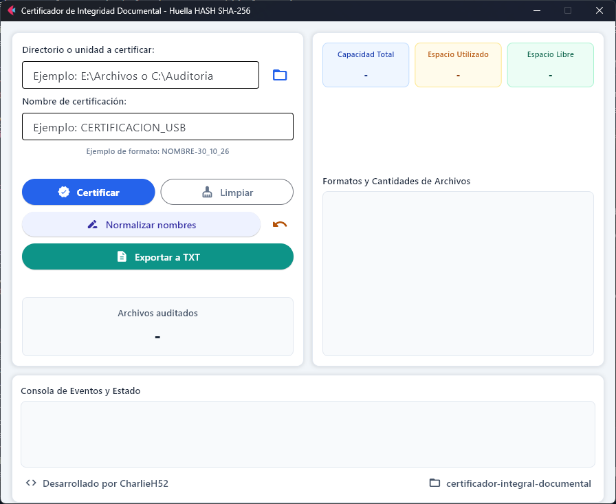
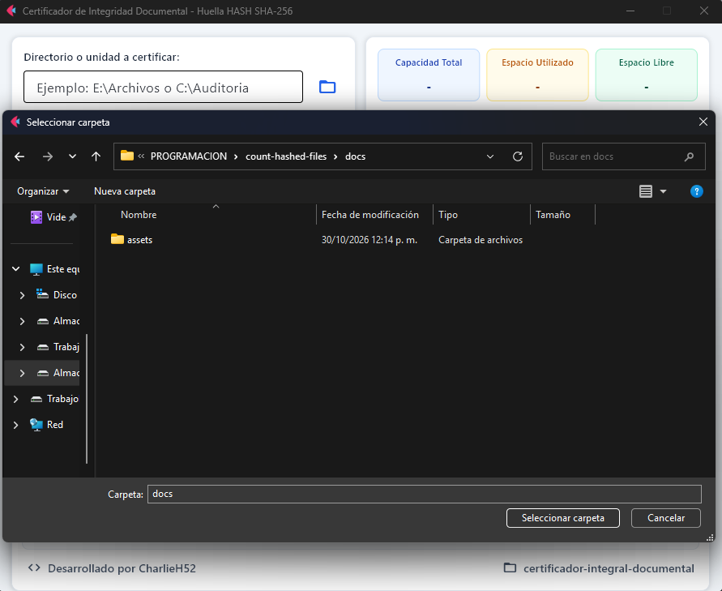
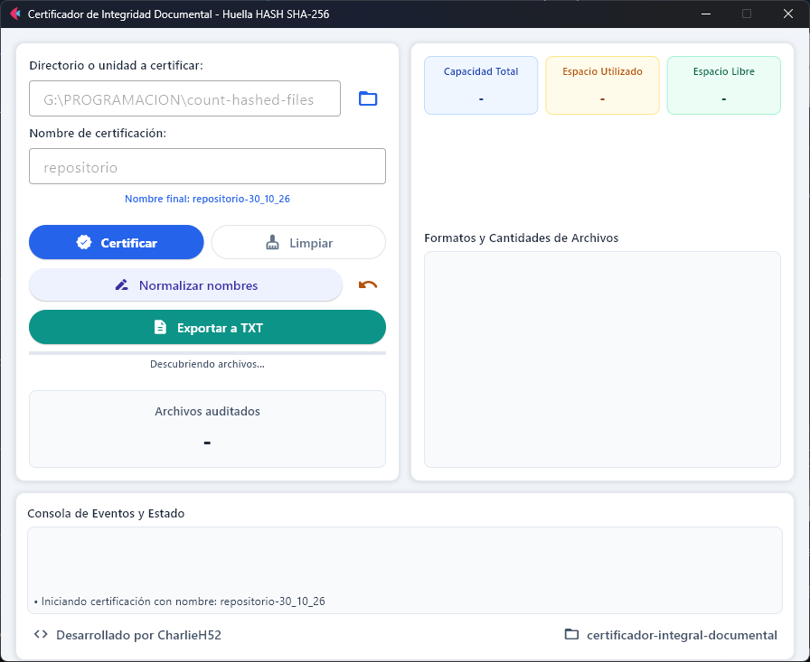
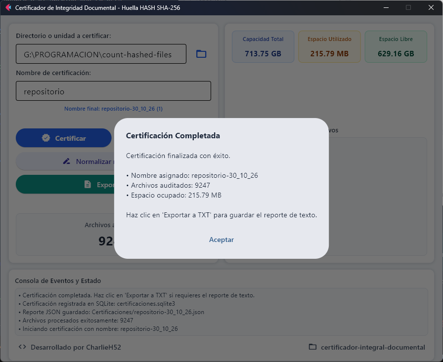
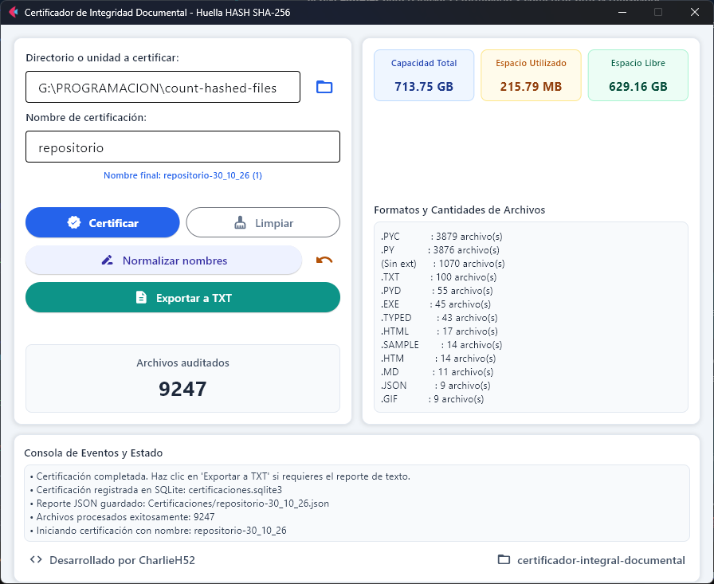
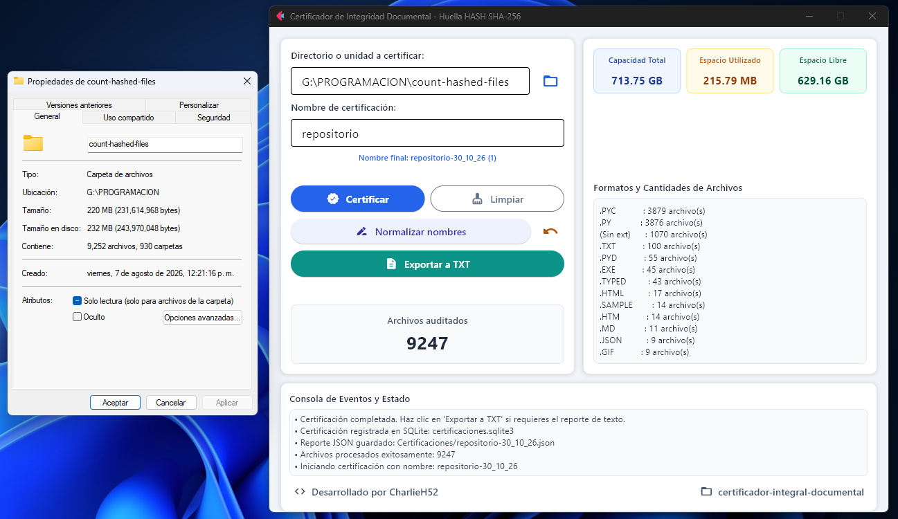
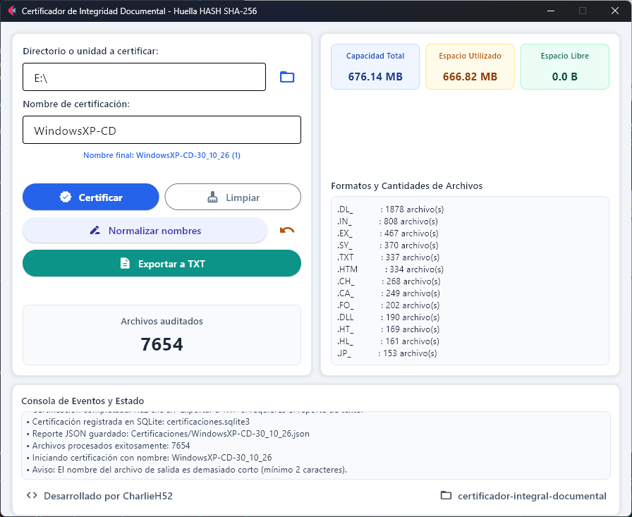
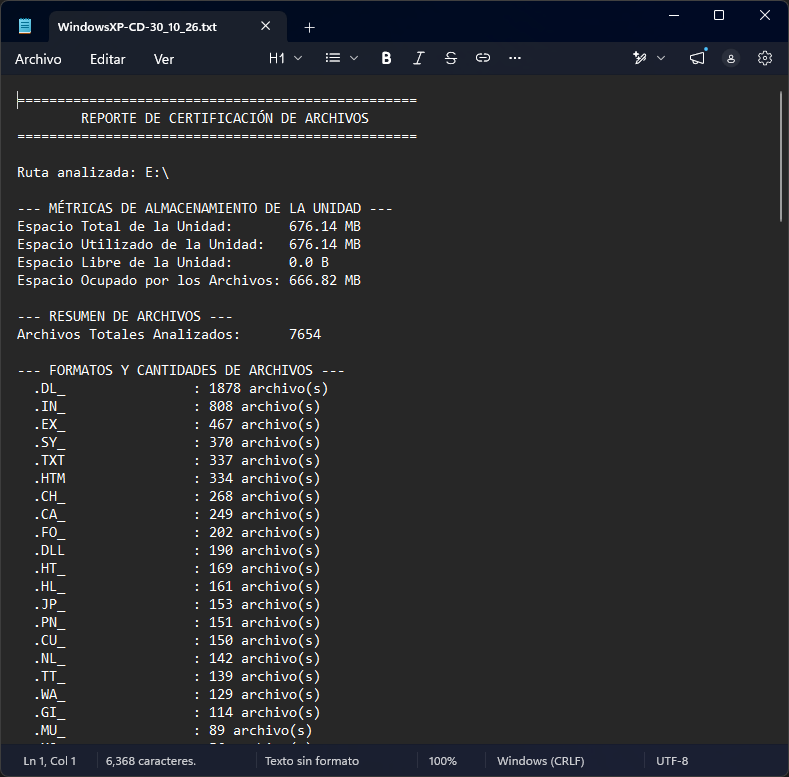
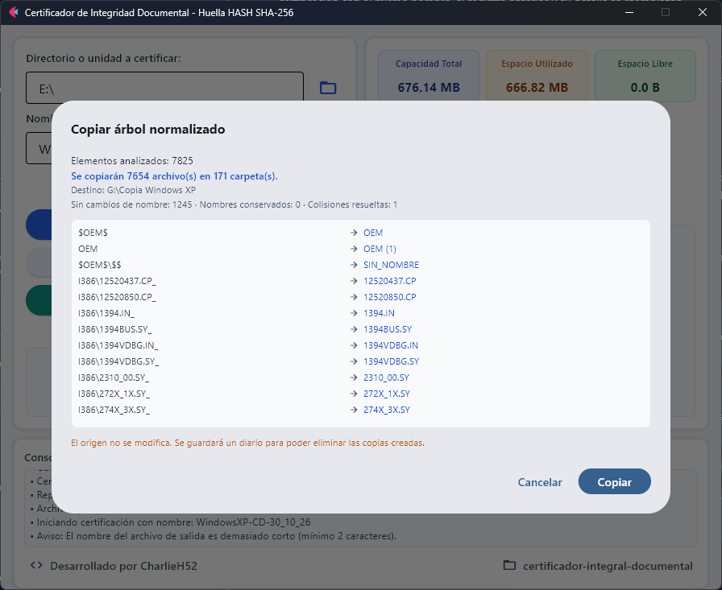
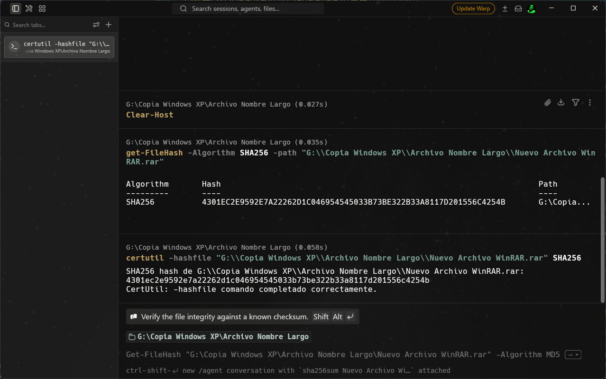

# Certificador de Integridad Documental

[](LICENSE)
[](https://www.python.org/)
[](https://flet.dev/)
[](#requisitos)

Aplicación de escritorio para Windows que recorre una unidad o carpeta, calcula la huella hash de cada archivo con el algoritmo configurado —SHA-256 por defecto— y genera reportes de integridad en JSON, SQLite3 y texto plano.

<div align="center">
  
</div>

## Tabla de contenido

- [Contexto](#contexto)
- [Características](#características)
- [Tecnologías utilizadas](#tecnologías-utilizadas)
- [Requisitos](#requisitos)
- [Instalación](#instalación)
- [Uso](#uso)
- [Resultados](#resultados)
- [Salidas generadas](#salidas-generadas)
- [Normalización de nombres](#normalización-de-nombres)
- [Configuración](#configuración)
- [Verificación de integridad](#verificación-de-integridad)
- [Pruebas](#pruebas)
- [Limitaciones y problemas frecuentes](#limitaciones-y-problemas-frecuentes)
- [Seguridad y privacidad](#seguridad-y-privacidad)
- [Estructura del proyecto](#estructura-del-proyecto)
- [Trabajo futuro](#trabajo-futuro)
- [Licencia y créditos](#licencia-y-créditos)
- [Capturas pendientes](#capturas-pendientes)

## Contexto

Anteriormente, un **órgano auditor** solía solicitar archivos expedidos por la organización para la que he trabajado; archivos que se envían aún en unidades extraíbles como USB, CD o DVD.

Estos archivos se solían enviar sin más. En la actualidad, este y otros órganos encargados de realizar auditorías han comenzado a solicitar respaldos digitales sobre el contenido de las unidades entregadas. Por ello se han comenzado a utilizar las certificaciones mediante huella hash; en nuestro caso particular se solicitan mediante el algoritmo `SHA256` junto con los datos mencionados en el primer párrafo. Esto tiene la finalidad de asegurar y mantener la integridad de la información que se entrega desde la organización.

El proceso planteado por el órgano consistía en una serie de pasos sistemáticos y varias aplicaciones libres muy sencillas. Decidí crear una herramienta centralizada que realizara exactamente lo que se solicita, con una interfaz directa, para eficientar un proceso que cada día es más solicitado en mi área de Sistemas.

La motivación principal fue convertir una actividad manual y repetitiva en un flujo único, reutilizable por otras áreas que tengan la misma necesidad. El algoritmo solicitado por auditoría es SHA-256; por eso es el valor predeterminado, aunque la configuración permite seleccionar otro algoritmo disponible en `hashlib`.

## Características

- Recorrido recursivo de la ruta seleccionada.
- Generación de huellas hash por bloques (*streaming*), con algoritmo configurable y SHA-256 por defecto.
- Conteo total de archivos auditados.
- Estadísticas y clasificación por formato o extensión.
- Cálculo del espacio total ocupado por los archivos analizados.
- Detección de capacidad total, espacio utilizado y libre en la unidad de almacenamiento.
- Nomenclatura automática con fecha (`nombre-DD_MM_YY`) y sufijos secuenciales anti-colisión.
- Selector interactivo para explorar directorios en el equipo.
- Barra de progreso reactiva en tiempo real.
- Exportación manual de reportes resumidos a texto plano (`.txt`).
- Persistencia configurable en repositorio JSON y base de datos SQLite3.
- Normalización opcional de nombres de archivos y carpetas, con vista previa, revisión manual de nombres largos y reversión.
- Advertencia cuando hay archivos que no se pudieron leer.
- Exclusión de directorios y archivos del sistema durante la normalización.

## Tecnologías utilizadas

- **Python 3.10+**, lenguaje de implementación.
- **Flet 0.85.3** y `flet-desktop`, interfaz gráfica de escritorio.
- **SQLite3**, persistencia relacional del histórico de certificaciones.
- **hashlib**, cálculo de huellas hash con el algoritmo configurado.
- **PyInstaller** mediante `flet pack`, empaquetado del ejecutable.
- **unittest**, pruebas automatizadas de la biblioteca estándar.

La aplicación se apoya en módulos de la biblioteca estándar como `os`, `shutil`, `json`, `sqlite3`, `hashlib` y `unittest`; no requiere servicios externos ni conexión a internet.

## Requisitos

| Componente | Requisito |
|---|---|
| Sistema operativo | Windows 10 u 11, preferentemente x64. |
| Python | 3.10 o superior para ejecutar desde el código fuente. |
| Flet | 0.85.3, instalado mediante `requirements.txt`. |
| Permisos | Lectura sobre la ruta que se desea certificar y escritura en el directorio de trabajo para guardar los reportes. |
| Espacio | Suficiente para el JSON, el TXT y la base SQLite3 generados. |

La aplicación está pensada y validada para Windows. Aunque Python es multiplataforma, el proyecto utiliza reglas de nombres reservados, límites de ruta y empaquetado específicos de Windows; no se distribuye para Linux ni macOS.

> Si solo se utiliza el ejecutable compilado, no es necesario instalar Python en el equipo destino.

## Instalación

### Ejecución desde el código fuente

```powershell
git clone https://github.com/CharlieH52/certificador-integral-documental.git
cd certificador-integral-documental
python -m venv venv
.\venv\Scripts\Activate.ps1
python -m pip install --upgrade pip
pip install -r requirements.txt
python .\main.py
```

Si PowerShell bloquea la activación del entorno virtual, se puede habilitar solo para la sesión actual:

```powershell
Set-ExecutionPolicy -Scope Process -ExecutionPolicy Bypass
.\venv\Scripts\Activate.ps1
```

También se puede activar desde `cmd`:

```cmd
.\venv\Scripts\activate.bat
```

### Compilación del ejecutable

```powershell
python .\build.py
```

El paquete se genera en `dist/`:

- Ejecutable único: `dist/CERTIFICADOR_INTEGRIDAD.exe`.
- Carpeta (`--onedir`): `dist/CERTIFICADOR_INTEGRIDAD/CERTIFICADOR_INTEGRIDAD.exe`.

Opciones disponibles:

```powershell
python .\build.py --clean    # limpia la caché de PyInstaller antes de compilar
python .\build.py --onedir   # genera una carpeta en lugar de un único .exe
```

Los parámetros de nombre, versión y descripción del ejecutable se configuran en las constantes superiores de `build.py`.

## Uso

1. Escribe la ruta de la unidad o carpeta que se desea certificar, o utiliza el botón de exploración.

<div align="center">
  
</div>

2. Escribe el nombre base de la certificación. La aplicación mostrará una vista previa del nombre final con la fecha, por ejemplo `CERTIFICACION_USB-30_10_26`.

3. Pulsa **Certificar**. La barra de progreso muestra el avance y el archivo que se está procesando.

<div align="center">
  
</div>

4. Al finalizar, revisa el modal de confirmación y el panel de resultados.

<div align="center">
  
</div>

5. Pulsa **Exportar a TXT** si necesitas el resumen en texto plano. El botón permanece deshabilitado hasta que exista una certificación completada.

6. Usa **Limpiar** para reiniciar el formulario y comenzar otra certificación.

7. Si necesitas normalizar nombres, hazlo **antes** de certificar. Las certificaciones guardan las rutas literales de los archivos.

## Resultados

La interfaz muestra:

- **Capacidad total** de la unidad analizada.
- **Espacio utilizado** de la unidad.
- **Espacio libre** de la unidad.
- **Archivos auditados**: cantidad de archivos procesados correctamente.
- **Espacio ocupado por los archivos**: suma de los tamaños individuales.
- **Lista de extensiones**: conteo por formato, ordenado de mayor a menor.
- **Estado actual**: mensajes del proceso y advertencias.

<div align="center">
  
</div>

Puede existir una ligera discrepancia entre el espacio ocupado que muestra la aplicación y el que marcan las propiedades de Windows. Influyen el tamaño de clúster, los metadatos del sistema de archivos, la compresión y otros factores propios del medio.

<div align="center">
  
</div>

En unidades de CD o DVD, y en algunos medios de solo lectura, el sistema puede no proporcionar información de capacidad. En ese caso la aplicación muestra `No disponible` o `0.0 B` en las métricas correspondientes.

<div align="center">
  
</div>

## Salidas generadas

Los reportes se crean en el **directorio de trabajo actual**, no necesariamente junto al ejecutable ni junto a la unidad certificada:

```text
Certificaciones/
├── NOMBRE-30_10_26.json
├── NOMBRE-30_10_26.txt
├── NOMBRE-30_10_26 (1).json      # si ya existía el mismo nombre
├── NOMBRE-30_10_26 (1).txt
└── normalizacion-20261030-143000.json
certificaciones.sqlite3
```

- `OUTPUT_DIRECTORY` define el nombre de la carpeta de reportes.
- `SQLITE_DB_NAME` define el nombre de la base de datos.
- El `.txt` **no se genera automáticamente**: solo al pulsar **Exportar a TXT**.
- El sufijo ` (1)`, ` (2)`, ... se calcula comprobando si ya existe el `.json` o el `.txt` con ese nombre.
- Si se ejecuta el `.exe` desde una carpeta sin permisos de escritura, los reportes no podrán guardarse.

### Reporte JSON

El JSON contiene una lista de archivos con tres campos:

```json
[
  {
    "Algorithm": "SHA256",
    "Hash": "BA7816BF8F01CFEA414140DE5DAE2223B00361A396177A9CB410FF61F20015AD",
    "Path": "E:\\Documentos\\archivo.pdf"
  }
]
```

El JSON no incluye el resumen de métricas ni el conteo por extensión; esos datos están en el TXT y en SQLite.

### Reporte de texto

El TXT incluye la ruta analizada, las métricas de la unidad, el total de archivos y el resumen por extensión:

```text
==================================================
        REPORTE DE CERTIFICACIÓN DE ARCHIVOS
==================================================

Ruta analizada: E:\Documentos

--- MÉTRICAS DE ALMACENAMIENTO DE LA UNIDAD ---
Espacio Total de la Unidad:       500.00 GB
Espacio Utilizado de la Unidad:   320.00 GB
Espacio Libre de la Unidad:       180.00 GB
Espacio Ocupado por los Archivos: 12.34 GB

--- RESUMEN DE ARCHIVOS ---
Archivos Totales Analizados:      126

--- FORMATOS Y CANTIDADES DE ARCHIVOS ---
  .PDF                : 45 archivo(s)
  .TXT                : 30 archivo(s)
  (Sin extensión)     : 1 archivo(s)
==================================================
```

<div align="center">
  
</div>

### Base de datos SQLite3

La base `certificaciones.sqlite3` contiene tres tablas:

| Tabla | Contenido |
|---|---|
| `certifications` | Registro maestro: nombre, ruta, total de archivos, tamaño, métricas de la unidad, algoritmo y fecha. |
| `certified_files` | Detalle por archivo: ruta, hash, tamaño y extensión. |
| `certification_extensions` | Resumen por extensión: extensión y cantidad de archivos. |

Incluye índices sobre `certification_id` y sobre `file_hash` para acelerar búsquedas. Si se guarda una certificación con el mismo nombre, el registro anterior y su detalle se reemplazan.

## Normalización de nombres

El botón **Normalizar nombres** trabaja sobre el contenido de la ruta seleccionada —nunca sobre la carpeta raíz— y aplica reglas deterministas para que los nombres sean portables y legibles.

Hay dos modos:

- **Renombrar en el lugar**: cambia los nombres en el disco y guarda un diario en `Certificaciones/normalizacion-AAAAMMDD-HHMMSS.json` para poder deshacer.
- **Copiar a otra carpeta**: deja el origen intacto y escribe el árbol normalizado en el destino, sin sobrescribir archivos existentes.

Antes de aplicar cualquier cambio se muestra una vista previa. Los nombres que exceden el límite disponible de la ruta abren un diálogo con contador en vivo y borde verde o rojo; la persona decide el nombre final u omite el renombrado. Nunca se trunca el nombre ni se agrega un hash automático.

<div align="center">
  
</div>

> 📷 **Captura pendiente — `docs/assets/screenshot-normalization-long-name.png`**
>
> Debe mostrar el diálogo de revisión de un nombre largo, con el contador de caracteres en vivo y el borde verde o rojo según el límite.

La explicación completa de reglas, modos, exclusiones, diario y reversión está en [`docs/Normalizacion.md`](docs/Normalizacion.md).

> [!NOTE]
> En medios ópticos o de solo lectura el renombrado en el lugar falla; en ese caso usa la copia normalizada. La normalización debe ejecutarse antes de certificar, porque las certificaciones guardan las rutas literales de los archivos.

## Configuración

La configuración global está en `config.py`:

| Variable | Valor por defecto | Efecto |
|---|---|---|
| `SAVE_JSON_CERTIFICATIONS` | `True` | Activa o desactiva el guardado del JSON. |
| `SAVE_SQLITE_CERTIFICATIONS` | `True` | Activa o desactiva el guardado en SQLite3. |
| `OUTPUT_DIRECTORY` | `"Certificaciones"` | Carpeta de salida de reportes y diarios. |
| `SQLITE_DB_NAME` | `"certificaciones.sqlite3"` | Nombre del archivo de base de datos. |
| `DEFAULT_HASH_ALGORITHM` | `"SHA256"` | Algoritmo usado para calcular los hashes. |
| `HASH_CHUNK_SIZE` | `65536` | Tamaño de bloque de lectura, en bytes. |
| `NORMALIZATION_ENABLED` | `True` | Muestra u oculta el botón de normalización. |
| `NORMALIZATION_PRESERVE_EXTENSIONS` | `True` | Conserva las extensiones, incluidas las compuestas. |
| `NORMALIZATION_KEEP_WORD_SEPARATORS` | `True` | Conserva guiones y guiones bajos como separadores. |
| `NORMALIZATION_FALLBACK_NAME` | `"SIN_NOMBRE"` | Nombre de respaldo cuando el resultado queda vacío. |
| `NORMALIZATION_MAX_COMPONENT_LENGTH` | `255` | Límite de caracteres por componente. |
| `NORMALIZATION_MAX_PATH_LENGTH` | `259` | Límite de la ruta completa en Windows. |
| `NORMALIZATION_IGNORED_DIRECTORIES` | Lista | Directorios que no se recorren ni se renombran. |
| `NORMALIZATION_IGNORED_FILES` | Lista | Archivos que se omiten durante la normalización. |
| `NORMALIZATION_OUTPUT_SUBDIR` | `"normalizado"` | Valor reservado; actualmente el destino se solicita de forma explícita. |

`DEFAULT_HASH_ALGORITHM` se resuelve con `hashlib.new()`. Acepta nombres como `SHA256`, `SHA-256`, `SHA1`, `MD5`, `SHA512` o `SHA3-256`; el valor se guarda en mayúsculas en el JSON y en SQLite. Si el algoritmo no está disponible en el intérprete, la certificación se detiene con un mensaje de error antes de recorrer la unidad.

## Verificación de integridad

Para comprobar un archivo contra el hash del reporte:

```powershell
Get-FileHash -Algorithm SHA256 -Path "E:\Documentos\archivo.pdf"
```

```cmd
certutil -hashfile "E:\Documentos\archivo.pdf" SHA256
```

```bash
sha256sum archivo.pdf
```

La aplicación guarda los hashes en hexadecimal y en mayúsculas. La comparación debe hacerse sin distinguir mayúsculas de minúsculas, pero verificando que coincida el algoritmo utilizado.

<div align="center">
  
</div>

## Pruebas

```powershell
python -m unittest discover -s tests
```

Las pruebas cubren:

- Reglas puras de normalización de nombres.
- Planificación, renombrado, copia y reversión del motor de normalización.
- Resolución de algoritmos de hash y cálculo por bloques.

No hay pruebas automatizadas de la interfaz gráfica ni del repositorio SQLite.

## Limitaciones y problemas frecuentes

- El tiempo de análisis depende del tamaño de la muestra y de la velocidad de lectura de la unidad.
- Los archivos bloqueados o sin permisos se omiten. La interfaz muestra cuántos no pudieron leerse, pero no exporta el detalle de cada error a los reportes.
- En medios ópticos o de solo lectura el renombrado en el lugar falla; debe usarse la copia normalizada.
- La certificación incluye archivos ocultos y de sistema que el usuario pueda leer; la normalización sí aplica sus propias listas de exclusión.
- El recorrido no sigue enlaces simbólicos de directorios.
- La aplicación mantiene en memoria las rutas y los registros de todos los archivos; volúmenes muy grandes pueden consumir bastante RAM.
- Las rutas que exceden el límite de Windows requieren revisión manual durante la normalización.
- La aplicación no compara certificaciones entre sí ni detecta cambios respecto a una certificación anterior.
- La disponibilidad de métricas de capacidad depende del medio y del sistema de archivos.
- `Certificaciones/` y `certificaciones.sqlite3` se crean en el directorio de trabajo actual; si se ejecuta desde una ubicación sin permisos de escritura, el guardado falla.

### Preguntas frecuentes

**¿Por qué el espacio ocupado no coincide exactamente con Windows?** Porque Windows reporta espacio asignado en clústeres e incluye metadatos del sistema de archivos. La aplicación suma los tamaños lógicos de los archivos.

**¿Por qué un CD o DVD muestra `0.0 B` o `No disponible`?** Porque algunos medios de solo lectura no exponen su capacidad o espacio libre de la misma forma que una unidad escribible.

**¿Dónde quedaron los reportes?** En la carpeta `Certificaciones/` del directorio de trabajo actual, y la base de datos en `certificaciones.sqlite3` del mismo directorio.

**¿La certificación modifica los archivos?** No. La certificación solo lee. La única función que modifica nombres es **Normalizar nombres**, y siempre muestra una vista previa antes de aplicar cambios.

**¿Puedo cambiar el algoritmo?** Sí, mediante `DEFAULT_HASH_ALGORITHM` en `config.py`, siempre que el algoritmo esté disponible en `hashlib`.

**¿Puedo deshacer una normalización?** Sí, con el botón **Deshacer** o a partir del diario generado. La reversión no sobrescribe archivos ajenos que ocupen el nombre original.

## Seguridad y privacidad

- Los reportes contienen rutas absolutas y el inventario completo de archivos.
- Los hashes no cifran ni protegen el contenido; solo permiten verificar integridad.
- Los archivos `.json`, `.txt` y `.sqlite3` pueden contener información sensible y deben almacenarse con acceso restringido.
- No se deben publicar capturas con rutas reales, nombres de personas o información interna sin sanitizarlas.
- La verificación debe hacerse contra una fuente confiable del hash original.

## Estructura del proyecto

```text
main.py
config.py
build.py
requirements.txt
LICENSE
view/
├── interface.py
└── normalization_dialog.py
service/
├── exporter.py
├── file_validator.py
├── generate.py
├── name_normalizer.py
└── normalization_engine.py
repository/
├── __init__.py
├── models.py
└── sqlite_repository.py
tests/
├── test_name_normalizer.py
├── test_normalization_engine.py
└── test_generate.py
docs/
├── assets/
│   └── capturas de la interfaz
├── Arquitectura.md
└── Normalizacion.md
```

- `view/`: interfaz Flet y diálogos.
- `service/`: hashing, validación, exportación y normalización.
- `repository/`: modelos de datos y persistencia SQLite3.
- `tests/`: pruebas unitarias.
- `config.py`: configuración global.
- `build.py`: empaquetado con `flet pack`.

Las decisiones de diseño y los formatos de salida se explican con más detalle en [`docs/Arquitectura.md`](docs/Arquitectura.md).

## Trabajo futuro

- Comparación entre certificaciones para detectar altas, bajas y cambios.
- Exportación a CSV.
- Verificación automatizada de una certificación completa.
- Más opciones de presentación de reportes.
- Validación en otras plataformas, si se generalizan las reglas de rutas y nombres.

## Licencia y créditos

Este proyecto se distribuye bajo la licencia **MIT**. Consulta [`LICENSE`](LICENSE).

- Autor: **Charlie Chan (CharlieH52)**.
- Repositorio: [github.com/CharlieH52/certificador-integral-documental](https://github.com/CharlieH52/certificador-integral-documental).
- Perfil: [github.com/CharlieH52](https://github.com/CharlieH52).
- Problemas y sugerencias: [issues del repositorio](https://github.com/CharlieH52/certificador-integral-documental/issues).

## Capturas pendientes

Queda pendiente una captura del diálogo de revisión de nombres largos:

- `docs/assets/screenshot-normalization-long-name.png`: debe mostrar el contador de caracteres en vivo y el borde verde o rojo según el límite disponible de la ruta.